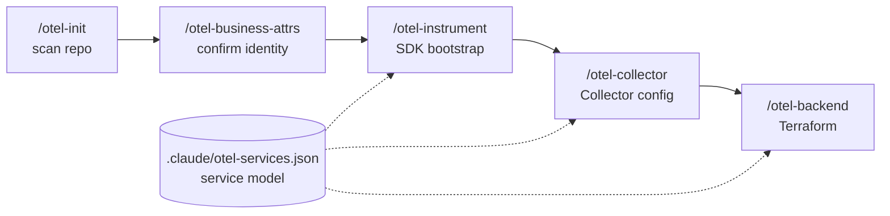

# otel-as-code

[](https://github.com/radra23/otel-as-code-plugin/actions/workflows/ci.yml)
[](LICENSE)
[](https://docs.claude.com/en/docs/claude-code/overview)
[](AGENTS.md)
[](https://github.com/radra23/otel-as-code-plugin/releases)
[](https://github.com/radra23/otel-as-code-plugin/discussions)

**Vendor-neutral OpenTelemetry for your repo, generated by your coding agent and checked by CI.**

otel-as-code is a Claude Code plugin (and a set of Codex skills) that reads your repo, works out
what your services are, and generates everything a working OpenTelemetry setup needs: the SDK
bootstrap for each service, the Collector config, and Terraform for dashboards, alerts, and SLOs
on Grafana, Datadog, New Relic, or Dash0.

It is built for teams whose main job is not observability: you want traces and metrics that
are correct and safe to deploy, without first becoming an OTel expert or finding roadmap space
to hand-roll it.

<!-- Demo: record and render with docs/demo/README.md, then uncomment the next two lines. -->
<!--  -->
<!-- <sub>Recorded live on the checkout-api fixture. The agent's working time is sped up; nothing else is edited.</sub> -->

| | |
|---|---|
| **Languages** | Node.js, Python, Java, .NET, Go, Ruby, Rust (axum, actix-web) |
| **Backends** | Grafana, Datadog, New Relic, Dash0 |
| **Agents** | Claude Code (plugin), Codex (skills) |
| **Semconv** | pinned to 1.45.0, drift-checked weekly |

## Install

```bash
claude plugin marketplace add https://github.com/radra23/otel-as-code-plugin
claude plugin install otel-as-code@otel-as-code
```

`marketplace add` registers the source; `plugin install` enables the plugin. For Codex, see
[Using with Codex](#using-with-codex). To hack on the plugin itself, see
[Development](#development).

## See your first span in a few minutes

In Claude Code, inside your repo:

```text
/otel-init               # scan the repo and detect services; offers to run the next two
/otel-instrument         # generate the OTel SDK bootstrap for one service
/otel-local              # free local Grafana stack in Docker, wired to that service
```

`/otel-local` is the recommended first step: it prints the Grafana URL and where your service's
traces, logs and metrics appear, and can check that the first trace arrived. It runs
`grafana/otel-lgtm`, a single open-source container that takes OTLP in, and nothing leaves your
machine. The generated code speaks plain OTLP, so you can swap the stack for any backend that
accepts OTLP without touching it.

No Docker? `/otel-local` says so and falls back to the console: start the instrumented service
with `OTEL_TRACES_EXPORTER=console` and hit any endpoint, and spans print to stdout. No
Collector, no backend, no account needed. `/otel-business-attrs` confirms the service name,
namespace and owner whenever you want to refine them.

When you are ready to send telemetry somewhere real:

```text
/otel-collector agent    # generate an otelcol-contrib config
/otel-backend grafana    # generate Terraform: dashboard, alerts, SLO
```

**Already have OTel?** Start with `/otel-evaluate` instead. It is a read-only audit that reports
coverage gaps, deprecated attributes, and cardinality risks, each with a finding ID. Apply only
the ones you want with `/otel-instrument --fix <ids>`.

## Why it exists

Hand-rolled OTel setups fail quietly, and the failures look like success.

- **The SDK default endpoint is an outage.** Every OTel SDK defaults to `localhost:4317`. Deploy a
  service without an endpoint and it drops every span while a reconnect loop burns CPU.
  otel-as-code defaults every exporter to `none` until an endpoint is configured (silence is the
  safer failure), and `/otel-instrument` finishes by naming the deployment files that need
  `OTEL_EXPORTER_OTLP_ENDPOINT` and offering to write it.
- **Attribute names drift.** Semantic conventions get renamed between releases, and a dashboard
  built on yesterday's names goes blank. Generated code is pinned to one semconv version, linted
  on every write, and checked weekly against upstream.
- **Every vendor's Terraform is written from scratch.** otel-as-code generates it from the same
  service model, so switching or adding a backend is one command, not a rewrite.

## How it works



`/otel-init` builds a service model of your repo (languages, frameworks, entry points, monorepo
members) and `/otel-business-attrs` has you confirm the parts that cannot be inferred safely.
Every generator after that reads the same model, so the service name in your SDK bootstrap, your
Collector config, and your dashboard queries always match.

## What gets generated

| Artifact | Files | Notes |
|---|---|---|
| **SDK bootstrap** | `tracing.js`, `tracing.py`, `tracing.go`, `tracing.rb`, `src/telemetry.rs`, `OpenTelemetry.cs`, or `otel-java.env` for the Java agent | Exporters chosen by the standard `OTEL_TRACES_EXPORTER` / `OTEL_METRICS_EXPORTER` / `OTEL_LOGS_EXPORTER` variables (`otlp`, `console`, `none`) |
| **Collector config** | `otelcol-agent.yaml` or `otelcol-gateway.yaml` | Ready for `otelcol-contrib`. Cardinality guardrails in agent mode, tail sampling in gateway mode |
| **Terraform module** | `infra/observability/<vendor>/` | Dashboard, alerts, and SLO. You run `plan` and `apply` |

The generated Terraform is a reviewed starting point that you own after generation, not a module
to depend on.

## Guardrails

Generating code into someone else's repo has to be safe to re-run. These run automatically while
the agent writes, in both Claude Code and Codex:

- **Write guard.** Blocks overwriting any file that carries the "generated by otel-as-code"
  ownership marker unless you pass `--force`. Hand-written files that happen to share a name
  (your own `main.tf` or `tracing.js`) are never blocked or touched.
- **Semconv lint.** Flags deprecated or non-conforming attribute names after every write.
  Advisory by default; set `OTEL_STRICT=1` (or create `.claude/.otel-strict`) to make severe
  violations block.
- **Session summary.** At the end of a session, prints a changelog of the generated files that
  changed, ready to paste into a PR description.
- **`--dry-run` everywhere.** Every writing command can preview a diff instead of writing, and
  exits non-zero when the output would change, so CI can catch drift.
- **Clean rollback.** `/otel-uninstrument` removes the bootstrap files it generated, and only
  those: the marker gate means it cannot delete a hand-written file, even with `--force`.

## What it runs and what it connects to

Nothing leaves your machine unless you set it up to. Generated code exports nowhere until you set
an endpoint (every exporter defaults to `none`), and the Collector config and Terraform only reach
a vendor once you deploy or apply them with your own credentials. The plugin has no telemetry of
its own and ships no MCP server.

What it runs, and when:

- **Hooks** (`hooks/hooks.json`, bash plus Python, no network calls). The write guard blocks
  overwriting a marker-carrying generated file without `--force`, and a full write of
  `.claude/otel-context.json` that holds an unconfirmed business attribute. It fails closed: if it
  finds no working Python, it blocks every Write and Edit and says how to fix it (install Python 3,
  or set `OTEL_HOOK_PYTHON`). Semconv lint is advisory unless strict mode is on, and runs after the
  write, so it can report but not undo it. Session summary only prints.
- **`/otel-local`** runs `docker compose` to start `grafana/otel-lgtm` (a public image from Docker
  Hub, about 1 GB on first pull), with every port bound to `127.0.0.1`, and checks it through
  `localhost` only.
- **`/otel-backend`** runs `terraform` (or `tofu`) `fmt`, `init -backend=false` and `validate`;
  `init` downloads the pinned providers from the public registry. It never runs `plan` or `apply`.
- **`/otel-instrument`** smoke-checks the result with the toolchain you already have (`node`,
  `python`, `dotnet build`, `go build`, `cargo check`, and so on), which can fetch dependencies the
  same way a normal build does. It prints `npm install` and similar commands for you; it does not
  run them.
- **`/otel-backend`, `/otel-collector` and `/otel-evaluate`** check whether a vendor MCP server is
  already connected and print a one-line tip. They never call it to generate anything.

## What is proven, and how

otel-as-code is pre-1.0. Here is exactly what CI verifies, so you know how far to trust each
piece.

**Instrumentation, end to end.** For each language below, CI wires the generated bootstrap into a
real app, exports through the generated Collector config into a running trace store, and asserts
on the spans, on every push (see [`tests/e2e/`](tests/e2e/)).

| Language | How | Traces | Metrics | Logs | OTLP | End-to-end in CI |
|---|---|---|---|---|---|---|
| Node.js | generated `tracing.js` | Stable | Stable | Development (`--experimental`) | gRPC :4317 | ✅ |
| Python | generated `tracing.py` | Stable | Stable | Development (`--experimental`) | gRPC :4317 | ✅ |
| Java | zero-code Java agent | Stable | Stable | Stable | gRPC :4317 | ✅ |
| .NET | generated `OpenTelemetry.cs` | Stable | Stable | Stable | gRPC :4317 | ✅ |
| Go | generated `tracing.go` | Stable | Stable | Beta | gRPC :4317 | ✅ |
| Ruby | `opentelemetry-instrumentation-all` | Stable | Development (`--experimental`) | Development (`--experimental`) | HTTP :4318 | ✅ |
| Rust (axum) | generated `src/telemetry.rs` | Beta | Stable | Stable | HTTP :4318 | ✅ |
| Rust (actix-web) | same `src/telemetry.rs` | Beta | Stable | Stable | HTTP :4318 | not yet: static and hook tests only |

**Terraform, live per backend.** Every module is `terraform validate`d on every push. The
[`tf-live-validate`](.github/workflows/tf-live-validate.yml) job goes further: it applies each
golden module against a real vendor account, reads the created resources back, and destroys them
(see [`tests/tf-live/`](tests/tf-live/)).

| Backend | Schema (`terraform validate`) | Live apply + readback |
|---|---|---|
| Dash0 | ✅ every push | ✅ proven |
| Grafana | ✅ every push | ✅ proven |
| New Relic | ✅ every push | ✅ proven |
| Datadog | ✅ every push | wired, awaiting a test account ([#121](https://github.com/radra23/otel-as-code-plugin/issues/121)) |

For Datadog, run `terraform plan` against your own account before trusting the output.

**Pins.** A weekly drift check compares the semconv, SDK, Java agent, crate, and Terraform
provider pins against current releases, and verifies every deprecated-attribute mapping against
the upstream registry. It opens and closes its own tracking issue.

## Supported languages in detail

Each generator refuses, with a reason, any shape it cannot instrument correctly, rather than
emitting a bootstrap that silently does nothing.

<details>
<summary><b>Node.js and Python</b></summary>

- Generated SDK bootstrap: `tracing.js` / `tracing.py`.
- Traces and metrics are Stable. Logs are Development and opt-in via `--experimental`.
- Browser SPAs are detected (`runtime: browser`) and refused: a Node SDK bootstrap cannot run in
  a bundle. Browser and RUM instrumentation is out of scope.
</details>

<details>
<summary><b>Java</b></summary>

- Zero-code OpenTelemetry Java agent. No source file is generated.
- The generator emits `otel-java.env`, a pinned agent download, and the run command.
- All signals Stable.
</details>

<details>
<summary><b>.NET</b></summary>

- Generates a marker-stamped `OpenTelemetry.cs` with an `AddOtelObservability()` DI extension,
  plus the one `Program.cs` line and the `dotnet add package` commands to wire it in. Your
  existing `Program.cs` and `.csproj` are not edited.
- Requires a hosted app (ASP.NET Core or Generic Host). A plain console app is refused.
- All signals Stable.
</details>

<details>
<summary><b>Go</b></summary>

- Generates `tracing.go`. `go.mod` is edited directly (`go mod tidy` resolves `go.sum`), and the
  two wiring lines for `main.go` are printed for you to paste. Your existing source is not edited.
- `net/http`-compatible servers only, which covers `chi` and `gorilla/mux`. `gin`, `echo`, and
  `fiber` are refused today.
- Traces and metrics Stable; logs Beta, generated by default.
</details>

<details>
<summary><b>Ruby</b></summary>

- Uses `opentelemetry-instrumentation-all`: one `use_all` call instruments whatever is present
  (Rails, Sinatra, Rack, database drivers, HTTP clients), so there is no framework refusal case.
- `Gemfile` is edited directly (`bundle install` resolves it). Rails apps get an auto-loaded
  initializer; for other apps the require line is printed, to be placed *after* your framework
  requires.
- Exports over OTLP/HTTP on `:4318`, because Ruby's OTLP gem does not support gRPC reliably.
- Traces Stable; metrics and logs Development, opt-in via `--experimental`.
</details>

<details>
<summary><b>Rust</b></summary>

- Generates `src/telemetry.rs`, identical for both frameworks since it only talks to
  `opentelemetry::global`. A marked dependency block is appended to `Cargo.toml`, and the lines
  for `main.rs` are printed: the module, `let _otel = telemetry::init();`, and the framework layer.
- **axum 0.8:** the `opentelemetry-instrumentation-tower` layer on the `Router`.
- **actix-web 4.x:** `opentelemetry-instrumentation-actix-web`'s `RequestTracing` and
  `RequestMetrics` middleware. Deliberately not `tracing-actix-web`, whose default root span uses
  pre-stable HTTP attribute names with no version fix.
- Logs are your `tracing` events, carrying the active span's IDs.
- Binaries only. Other frameworks, older axum, and library crates are refused.
- Exports over OTLP/HTTP on `:4318`. Traces Beta (marked as such in the generated file); metrics
  and logs Stable.
</details>

**Not yet supported:** PHP is detected and refused with a reason; a generator is at the design
stage ([#117](https://github.com/radra23/otel-as-code-plugin/issues/117)). Services with no
application source but native OTel support (third-party images) can get a deployment-config diff
from `/otel-remediate` instead; v1 covers Keycloak only.

## Commands

| Command | Purpose |
|---|---|
| `/otel-init` | First-run setup: scan the repo, detect services, prime the context cache |
| `/otel-business-attrs` | Infer and confirm service identity, ownership, and business-metric candidates |
| `/otel-instrument [lang]` | Generate the SDK bootstrap (or Java agent config) for one service |
| `/otel-evaluate` | Read-only audit of existing OTel: coverage gaps, semconv conformance, cardinality risks |
| `/otel-collector [agent\|gateway]` | Generate an `otelcol-contrib` config |
| `/otel-backend <vendor>` | Generate Terraform for `grafana`, `datadog`, `newrelic`, or `dash0` |
| `/otel-uninstrument` | Remove the bootstrap files `/otel-instrument` generated (marker-gated) |
| `/otel-local` | Start a free local Grafana stack (`grafana/otel-lgtm`) in Docker, wired to one service; `--down` stops it |
| `/otel-remediate` | Print a deployment-config diff for a service with native OTel but no app source to bootstrap (v1: Keycloak) |

## Flags

| Flag | Commands | Effect |
|---|---|---|
| `--service <id>` | instrument, backend, uninstrument, remediate | Pick the target service instead of being prompted. `backend` also accepts `all` (one module per service) |
| `--dry-run` | instrument, collector, backend, uninstrument | Preview a diff without writing; exits non-zero if anything would change |
| `--experimental` | instrument, collector, backend | Unlock pre-Stable semconv and signals |
| `--fix <ids>` | instrument | Apply only these `/otel-evaluate` findings, in place |
| `--force` | instrument, collector, backend, uninstrument | **Full regeneration**, overwrites hand edits (see below). For `uninstrument`, skips the confirmation prompt |
| `--public` | collector | The Collector has no private-network path to its senders: adds receiver auth (`bearertokenauth`). Needs TLS in front to mean anything. Default is unauthenticated |
| `--exporter-header <Name=${env:VAR}>` | collector | Add a header to the OTLP exporter. Values must reference an env var, never a literal secret |
| `--cardinality-budget <N>` | collector | Gateway mode, with `--experimental`: generate a metrics cardinality ceiling that drops what exceeds it |
| `--confirm-remove-auth` | collector | Required with `--force` (and without `--public`) to intentionally strip existing receiver auth |
| `--confirm-remove-exporter-auth` | collector | Required with `--force` to regenerate over exporter auth the new config cannot carry |
| `--kind <dashboard\|alerts\|slo>` | backend | Emit one artifact instead of all three |
| `--output-dir <path>` | backend | Override the default `infra/observability/<vendor>/` |
| `--self-hosted` | backend (grafana) | Target self-hosted Grafana: a burn-rate alert rule instead of `grafana_slo`, which is Cloud-only |
| `--yes` | backend | Answer yes to confirmation prompts, for CI or another agent. Never implies `--force` |
| `--all` | uninstrument | Remove every marker-carrying bootstrap in the repo |
| `--local-ignore` | init | Write ignore rules to `.git/info/exclude` instead of `.gitignore`, for repos you must leave clean |
| `--no-cache-write` | evaluate | Audit without writing anything to disk, not even the context cache |

**`--force` regenerates; it does not patch.** By the time regeneration is worth running, the
bootstrap has usually been hand-refined, so `/otel-instrument` prints what it will overwrite and
asks first. To apply audit findings without losing your edits, use `--fix <ids>` instead. For
`/otel-collector`, `--force` alone refuses to remove existing receiver auth: pair it with
`--public` to keep auth, or `--confirm-remove-auth` to downgrade on purpose.

## Context cache

otel-as-code writes two files:

- `.claude/otel-services.json`: your team's service map. **Commit this.**
- `.claude/otel-context.json`: an ephemeral scan cache. Gitignored.

Re-scanning is a merge, not a replace: facts read from the repo are refreshed, and everything you
confirmed (business attributes, namespace, resolved service-name conflicts) is kept. Freshness is
keyed to a fingerprint of the service-identity files (manifests, Dockerfiles, CODEOWNERS), so
commits that only touch application code do not trigger a full re-scan.

If your `.gitignore` excludes all of `.claude/`, `/otel-init` points out that the service map is
ignored with it and offers the `.claude/*` plus `!.claude/otel-services.json` rewrite (git cannot
un-ignore a file inside an excluded directory).

## Using with Codex

The same capabilities ship as Codex skills under `.agents/skills/`. Codex discovers them when
this repo is your working directory (or vendored into one, for example as a git submodule).
Invoke a workflow with `$name`:

```text
$otel-init
$otel-business-attrs
$otel-instrument
$otel-collector agent
$otel-backend datadog
```

Each skill is a thin bridge to the canonical `commands/`, `skills/`, and `agents/` files, so
there is one source of truth. The guardrails run in Codex too (`.codex/hooks.json`). The one
difference: Codex has no subagent dispatch, so where a command says "dispatch the `<x>` agent",
Codex reads `agents/<x>.md` and does the work inline. Full guide: [`AGENTS.md`](AGENTS.md).

## Development

```bash
git clone https://github.com/radra23/otel-as-code-plugin
claude --plugin-dir /path/to/otel-as-code-plugin   # loads the plugin with hot-reload
```

[CONTRIBUTING.md](CONTRIBUTING.md) covers the conventions, the single-source-of-truth rules, and
how to run the tests locally.

## Contributing

Questions, bug reports, and "I ran this on my repo and here is what came out" are all welcome.
That last one is the most useful thing anyone can send: every generator bug found so far came
from a codebase shape nobody had tried yet.

- [Incorrect output](https://github.com/radra23/otel-as-code-plugin/issues/new?template=02-incorrect-output.yml)
  is the issue form for "the generated file was wrong".
- [Discussions](https://github.com/radra23/otel-as-code-plugin/discussions) is for questions and
  half-formed ideas. Issues are for things that are broken or missing.
- [ROADMAP.md](ROADMAP.md) shows where this is going, and what it deliberately will not do.
- [evals/routing/](evals/routing/README.md) checks whether a fresh Claude Code session picks this
  plugin for "add OpenTelemetry" requests and leaves one-off debugging alone. It makes real model
  calls, so it runs on demand.

## License

Apache-2.0, aligned with the OpenTelemetry ecosystem.
