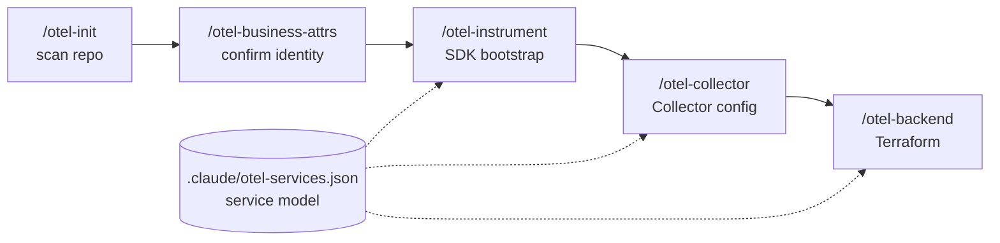

# otel-as-code

[](https://github.com/radra23/otel-as-code-plugin/actions/workflows/ci.yml)
[](https://github.com/radra23/otel-as-code-plugin/blob/main/LICENSE)
[](https://docs.claude.com/en/docs/claude-code/overview)
[](https://github.com/radra23/otel-as-code-plugin/blob/main/AGENTS.md)
[](https://github.com/radra23/otel-as-code-plugin/releases)
[](https://github.com/radra23/otel-as-code-plugin/discussions)

**OpenTelemetry set up for you by your coding agent: checked as it is written, proven in CI, and showing your first trace on your own machine today.**

You don't need to know OpenTelemetry. otel-as-code is a plugin for Claude Code (and a set of
skills for Codex) that reads your repo and adds what it takes to see what your services are
doing: which requests are slow, which ones fail, and where the time goes.

<!-- Demo: record and render with docs/demo/README.md, then uncomment the next two lines. -->
<!--  -->
<!-- <sub>Recorded live on the checkout-api fixture. The agent's working time is sped up; nothing else is edited.</sub> -->

## Install

```bash
claude plugin marketplace add https://github.com/radra23/otel-as-code-plugin
claude plugin install otel-as-code@otel-as-code
```

`marketplace add` registers the source; `plugin install` enables the plugin. Using Codex? See
[Using with Codex](#using-with-codex). To work on the plugin itself, see
[Development](#development).

## Your first trace

In Claude Code, inside your repo:

```text
/otel-init
```

It finds your services, then asks if you want to see one running locally. Say yes. It sets up
tracing for that service and starts a free Grafana dashboard in Docker on your machine, then tells
you where your first trace appears. No account, and nothing leaves your machine. No Docker? The
traces print in your terminal instead. The same steps one at a time are in
[Step by step](#step-by-step-and-sending-it-somewhere-real).

## What you get

- **Tracing set up for each service**, in Node.js, Python, Java, .NET, Go, Ruby, Rust or PHP.
  Requests, errors and timings are recorded without you writing any of it.
- **Your own functions and business numbers tracked**, such as "orders placed" or "time to pay"
  (`/otel-enrich`; Node.js and Python today).
- **A test that fails when the tracing goes missing**, so a refactor can't silently break it
  (`/otel-test`; Node.js and Python today).
- **Dashboards and alerts as code**, for Grafana, Datadog, New Relic or Dash0.
- **All of it removable.** Everything the plugin writes is marked as its own, and
  `/otel-uninstrument` takes it out again.

## How we know it works

Each line links to the test that backs it.

- **Checked as it is written.** Two checks run on their own while the agent writes: one refuses
  to overwrite a generated file by accident, one flags outdated attribute names.
  [Hook tests](https://github.com/radra23/otel-as-code-plugin/blob/main/tests/hooks/), run on Linux and Windows on [every push](https://github.com/radra23/otel-as-code-plugin/blob/main/.github/workflows/ci.yml).
- **The setup is run for real.** For Node.js, Python, Java, .NET, Go, Ruby and Rust (axum), CI
  puts the generated setup into a real app and checks the traces arrive. PHP and Rust (actix-web)
  are not run yet. [Results per language](#what-is-proven-and-how) · [tests](https://github.com/radra23/otel-as-code-plugin/blob/main/tests/e2e/)
- **The first trace on your machine.** CI starts the same local dashboard and reads the trace
  back. [Test](https://github.com/radra23/otel-as-code-plugin/blob/main/tests/e2e/local-stack.sh)
- **Your functions and business numbers.** CI adds them to real apps, runs the dashboard's own
  queries until they return data, then removes them and compares the files byte for byte.
  [Test](https://github.com/radra23/otel-as-code-plugin/blob/main/tests/e2e/enrich.sh)
- **The generated test really fails.** CI removes the tracing from real apps and requires the
  test to fail and name what is missing. [Test](https://github.com/radra23/otel-as-code-plugin/blob/main/tests/e2e/telemetry-test.sh)
- **Dashboards and alerts are checked on every push, and applied to a real account on Dash0.**
  Every module passes `terraform validate`. On Dash0, a weekly job also creates the resources in
  a real account, reads them back and deletes them. Grafana, New Relic and Datadog are wired into
  the same job but have not been applied by it yet: it has no credentials for them.
  [Results per backend](#what-is-proven-and-how) · [job](https://github.com/radra23/otel-as-code-plugin/blob/main/.github/workflows/tf-live-validate.yml)
- **Your agent picks it when you ask.** In 36 of 36 runs, a fresh session given a plain request
  such as "add tracing" used the plugin. Measured at version 0.10.0, before `/otel-enrich` and
  `/otel-test` existed. [Routing eval](https://github.com/radra23/otel-as-code-plugin/blob/main/evals/routing/README.md)

## Commands

Every command, and what it does for you. Arguments and flags are in
[Command reference](#command-reference) and [Flags](#flags).

| | Command | What it does for you |
|---|---|---|
| **Start here** | `/otel-init` | Looks through your repo, finds your services, and offers to get the first one running on your machine |
| | `/otel-instrument` | Sets up tracing for one service. It adds a setup file; your own source files are left alone |
| | `/otel-local` | Starts a free dashboard on your machine (Docker) and shows where your traces, logs and metrics are. `--down` stops it |
| **Go further** | `/otel-business-attrs` | Confirms with you what each service is called, who owns it, and which business numbers are worth tracking |
| | `/otel-enrich` | Tracks one of your own functions, the business numbers you confirmed, or database and queue calls that were missed (Node.js, Python). It shows you the change first |
| | `/otel-test` | Writes a test that fails when the tracing goes missing (Node.js, Python) |
| | `/otel-evaluate` | Already have OpenTelemetry? Reviews it and lists what is missing or out of date. Changes nothing |
| | `/otel-collector` | Writes the config for the OpenTelemetry Collector, the program that receives your traces and passes them on to a vendor |
| | `/otel-backend` | Writes dashboards, alerts and a service-level objective as Terraform for Grafana, Datadog, New Relic or Dash0. You review and apply it |
| | `/otel-remediate` | For a service you run but did not write (Keycloak today): prints the settings that turn on its built-in tracing |
| **Undo** | `/otel-uninstrument` | Removes the files the plugin generated, and only those. `--enrichment` removes what `/otel-enrich` added to your code |

The rest of this page is reference. It uses OpenTelemetry's own vocabulary, for when you want to
know exactly what is generated, how it is checked, and how to change it.

## Step by step, and sending it somewhere real

In Claude Code, inside your repo:

```text
/otel-init               # scan the repo and detect services; offers to run the next two
/otel-instrument         # generate the OTel SDK bootstrap for one service
/otel-local              # free local Grafana stack in Docker, wired to that service
```

`/otel-local` is the recommended first step: it prints the Grafana URL and where your service's
traces, logs and metrics appear, and can check that the first trace arrived. It runs
`grafana/otel-lgtm`, a single open-source container that takes OTLP in, and nothing leaves your
machine. The generated code speaks plain OTLP, so you can swap the stack for any backend that
accepts OTLP without touching it.

No Docker? `/otel-local` says so and falls back to the console: start the instrumented service
with `OTEL_TRACES_EXPORTER=console` and hit any endpoint, and spans print to stdout. No
Collector, no backend, no account needed. `/otel-business-attrs` confirms the service name,
namespace and owner whenever you want to refine them.

When you are ready to send telemetry somewhere real:

```text
/otel-collector agent    # generate an otelcol-contrib config
/otel-backend grafana    # generate Terraform: dashboard, alerts, SLO
```

**Already have OTel?** Start with `/otel-evaluate` instead. It is a read-only audit that reports
coverage gaps, deprecated attributes, and cardinality risks, each with a finding ID. Apply only
the ones you want with `/otel-instrument --fix <ids>`.

## For people who know OpenTelemetry

**Vendor-neutral OpenTelemetry for your repo, generated by your coding agent and checked by CI.**

otel-as-code is a Claude Code plugin (and a set of Codex skills) that reads your repo, works out
what your services are, and generates everything a working OpenTelemetry setup needs: the SDK
bootstrap for each service, the Collector config, and Terraform for dashboards, alerts, and SLOs
on Grafana, Datadog, New Relic, or Dash0.

It is built for teams whose main job is not observability: you want traces and metrics that
are correct and safe to deploy, without first becoming an OTel expert or finding roadmap space
to hand-roll it.

| | |
|---|---|
| **Languages** | Node.js, Python, Java, .NET, Go, Ruby, Rust (axum, actix-web), PHP |
| **Backends** | Grafana, Datadog, New Relic, Dash0 |
| **Agents** | Claude Code (plugin), Codex (skills) |
| **Semconv** | pinned to 1.45.0, drift-checked weekly |

## Why it exists

Hand-rolled OTel setups fail quietly, and the failures look like success.

- **The SDK default endpoint is an outage.** Every OTel SDK defaults to `localhost:4317`. Deploy a
  service without an endpoint and it drops every span while a reconnect loop burns CPU.
  otel-as-code defaults every exporter to `none` until an endpoint is configured (silence is the
  safer failure), and `/otel-instrument` finishes by naming the deployment files that need
  `OTEL_EXPORTER_OTLP_ENDPOINT` and offering to write it.
- **Attribute names drift.** Semantic conventions get renamed between releases, and a dashboard
  built on yesterday's names goes blank. Generated code is pinned to one semconv version, linted
  on every write, and checked weekly against upstream.
- **Every vendor's Terraform is written from scratch.** otel-as-code generates it from the same
  service model, so switching or adding a backend is one command, not a rewrite.

## How it works



`/otel-init` builds a service model of your repo (languages, frameworks, entry points, monorepo
members) and `/otel-business-attrs` has you confirm the parts that cannot be inferred safely.
Every generator after that reads the same model, so the service name in your SDK bootstrap, your
Collector config, and your dashboard queries always match.

## What gets generated

| Artifact | Files | Notes |
|---|---|---|
| **SDK bootstrap** | `tracing.js`, `tracing.py`, `tracing.go`, `tracing.rb`, `src/telemetry.rs`, `telemetry.php`, `OpenTelemetry.cs`, or `otel-java.env` for the Java agent | Exporters chosen by the standard `OTEL_TRACES_EXPORTER` / `OTEL_METRICS_EXPORTER` / `OTEL_LOGS_EXPORTER` variables (`otlp`, `console`, `none`) |
| **Collector config** | `otelcol-agent.yaml` or `otelcol-gateway.yaml` | Ready for `otelcol-contrib`. Cardinality guardrails in agent mode, tail sampling in gateway mode |
| **Terraform module** | `infra/observability/<vendor>/` | Dashboard, alerts, and SLO. You run `plan` and `apply` |

The generated Terraform is a reviewed starting point that you own after generation, not a module
to depend on.

## Guardrails

Generating code into someone else's repo has to be safe to re-run. Three hooks run on their own
while the agent writes:

- **Write guard** (Claude Code and Codex). Blocks overwriting a generated file that carries the
  "generated by otel-as-code" ownership marker unless you pass `--force`. It checks the names the
  plugin generates: the SDK bootstraps, `otel-java.env`, the Collector and local-stack configs, and
  Terraform `main.tf` / `variables.tf` / `outputs.tf` in any directory. A hand-written file that
  shares one of those names (your own `main.tf` or `tracing.js`) has no marker and is not blocked,
  except when no working Python is found: then the guard fails closed and blocks writes to those
  names. It also refuses to write `.claude/otel-context.json` with a business attribute that is not
  confirmed. In Codex, an `apply_patch` may change that cache only as one full-file Add; an Update,
  Move or Delete of it is denied.
- **Semconv lint** (Claude Code and Codex). After a write to a file that uses an OTel API, flags
  deprecated or non-conforming attribute names. Advisory by default. Set `OTEL_STRICT=1` (or create
  `.claude/.otel-strict`) and severe violations come back to the agent as an error it must fix; the
  write has already landed, so the lint cannot undo it. Strict mode needs Python: without it, the
  lint says the checks did not run and stops nothing.
- **Session summary** (Claude Code only). When a session ends, prints a changelog of the
  otel-as-code files changed in the working tree, ready to paste into a PR description. It reads
  `git status`, so it lists every such change in the tree, not only this session's. It is not
  ported to Codex.

In Codex the two hooks load only when otel-as-code is the project root: `.codex/hooks.json`
finds its adapters through `git rev-parse --show-toplevel`. When this repo is vendored inside
another one, Codex runs the skills without the hooks.

Two command features keep re-runs safe too:

- **`--dry-run`.** `/otel-instrument`, `/otel-collector`, `/otel-backend`, `/otel-local`,
  `/otel-enrich`, `/otel-test` and `/otel-uninstrument` can preview a diff (or the removal plan) instead of writing, and exit
  non-zero when something would change, so CI can catch drift. `/otel-init` and
  `/otel-business-attrs` write only the context cache and have no dry run; `/otel-evaluate
  --no-cache-write` writes nothing.
- **Edits to your own code are opt-in.** Only `/otel-enrich` changes a file you wrote. It shows
  the diff and asks first, adds lines between `otel-as-code: enrich` markers without changing any
  existing line, and refuses unless the result still parses. `/otel-uninstrument --enrichment`
  removes exactly those lines.
- **Clean rollback.** `/otel-uninstrument` removes the bootstrap files it generated, and only
  those: the marker gate means it cannot delete a hand-written file, even with `--force`.

## What it runs and what it connects to

Nothing leaves your machine unless you set it up to. Generated code exports nowhere until you set
an endpoint (every exporter defaults to `none`), and the Collector config and Terraform only reach
a vendor once you deploy or apply them with your own credentials. The plugin has no telemetry of
its own and ships no MCP server.

What it runs, and when:

- **Hooks** (`hooks/hooks.json`, bash plus Python, no network calls). The write guard blocks
  overwriting a marker-carrying generated file without `--force`, and a write or edit of
  `.claude/otel-context.json` that holds an unconfirmed business attribute. It fails closed: if it
  finds no working Python, it blocks writes to the files it protects (generated files, Terraform
  module files, the context cache) and says how to fix it (install Python 3, or set
  `OTEL_HOOK_PYTHON`); writes to any other file go ahead unchecked. Semconv lint is advisory unless strict mode is on, and runs after the
  write, so it can report but not undo it. Session summary only prints.
- **`/otel-local`** runs `docker compose` to start `grafana/otel-lgtm` (a public image from Docker
  Hub, about 1 GB on first pull), with every port bound to `127.0.0.1`, and checks it through
  `localhost` only.
- **`/otel-backend`** runs `terraform` (or `tofu`) `fmt`, `init -backend=false` and `validate`;
  `init` downloads the pinned providers from the public registry. It never runs `plan` or `apply`.
- **`/otel-instrument`** smoke-checks the result with the toolchain you already have (`node`,
  `python`, `dotnet build`, `go build`, `cargo check`, and so on), which can fetch dependencies the
  same way a normal build does. It prints `npm install` and similar commands for you; it does not
  run them.
- **`/otel-backend`, `/otel-collector` and `/otel-evaluate`** check whether a vendor MCP server is
  already connected and print a one-line tip. They never call it to generate anything.

## What is proven, and how

otel-as-code is pre-1.0. Here is exactly what CI verifies, so you know how far to trust each
piece.

**Instrumentation, end to end.** For each language below, CI wires the generated bootstrap into a
real app, exports through the generated Collector config into a running trace store, and asserts
on the spans, on every push (see [`tests/e2e/`](https://github.com/radra23/otel-as-code-plugin/blob/main/tests/e2e/)).

| Language | How | Traces | Metrics | Logs | OTLP | End-to-end in CI |
|---|---|---|---|---|---|---|
| Node.js | generated `tracing.js` | Stable | Stable | Development (`--experimental`) | gRPC :4317 | ✅ |
| Python | generated `tracing.py` | Stable | Stable | Development (`--experimental`) | gRPC :4317 | ✅ |
| Java | zero-code Java agent | Stable | Stable | Stable | gRPC :4317 | ✅ |
| .NET | generated `OpenTelemetry.cs` | Stable | Stable | Stable | gRPC :4317 | ✅ |
| Go | generated `tracing.go` | Stable | Stable | Stable | gRPC :4317 | ✅ |
| Ruby | `opentelemetry-instrumentation-all` | Stable | Development (`--experimental`) | Development (`--experimental`) | HTTP :4318 | ✅ |
| Rust (axum) | generated `src/telemetry.rs` | Beta | Stable | Stable | HTTP :4318 | ✅ |
| Rust (actix-web) | same `src/telemetry.rs` | Beta | Stable | Stable | HTTP :4318 | not yet: static and hook tests only |
| PHP | generated `telemetry.php` | Stable | Stable | Stable | HTTP :4318 | not yet: static and hook tests only, never run against a PHP runtime |

**Terraform, live per backend.** Every module is `terraform validate`d on every push. The
[`tf-live-validate`](https://github.com/radra23/otel-as-code-plugin/blob/main/.github/workflows/tf-live-validate.yml) job goes further: it applies each
golden module against a real vendor account, reads the created resources back, and destroys them
(see [`tests/tf-live/`](https://github.com/radra23/otel-as-code-plugin/blob/main/tests/tf-live/)).

| Backend | Schema (`terraform validate`) | Live apply + readback |
|---|---|---|
| Dash0 | ✅ every push | ✅ applied weekly by the job |
| Grafana | ✅ every push | wired, never applied by the job: no credentials set |
| New Relic | ✅ every push | wired, never applied by the job: no credentials set |
| Datadog | ✅ every push | wired, awaiting a test account ([#121](https://github.com/radra23/otel-as-code-plugin/issues/121)) |

This table is read from the job's own run history (every run since 2026-09-03): each one applied
Dash0 and skipped the others. The Dash0 leg has caught real breaks that `terraform validate`
cannot see, most recently an SLO query shape Dash0 stopped accepting (fixed in 0.21.1). For
Grafana, New Relic and Datadog, run `terraform plan` against your own account before trusting
the output.

**Pins.** A weekly drift check compares the semconv, SDK, Java agent, crate, and Terraform
provider pins against current releases, and verifies every deprecated-attribute mapping against
the upstream registry. It opens and closes its own tracking issue.

## Supported languages in detail

Each generator refuses, with a reason, any shape it cannot instrument correctly, rather than
emitting a bootstrap that silently does nothing.

<details>
<summary><b>Node.js and Python</b></summary>

- Generated SDK bootstrap: `tracing.js` / `tracing.py`.
- Traces and metrics are Stable. Logs are Development and opt-in via `--experimental`.
- Runtime metrics are on with no code of yours: the event loop and heap in Node.js (`nodejs.*`,
  `v8js.*`), and this process's CPU, memory, threads and garbage collection in Python
  (`process.*`, `cpython.*`). The Python ones come from a beta package that needs `psutil`; if it
  is not installed the service still starts and says so once.
- FastAPI 0.142.0 and later reports its own request spans and duration metric, under the names
  the generated dashboards query. The Python bootstrap leaves that on and calls
  `opentelemetry-instrumentation-fastapi` only on older FastAPI, where it is still needed. One
  server span per request either way, held in CI on both sides
  ([`tests/e2e/fastapi-native.sh`](https://github.com/radra23/otel-as-code-plugin/blob/main/tests/e2e/fastapi-native.sh)). If you regenerate an existing
  FastAPI service, its metric and attribute names move from the old HTTP names to the stable ones;
  `OTEL_AS_CODE_FASTAPI_SOURCE=package` keeps the old behaviour.
- Log lines say which trace they belong to, with your logger and format left as they are. In
  Node.js, pino, winston and bunyan lines gain `trace_id` and `span_id` fields; `console.log` does
  not. In Python, lines from the standard `logging` module get ` trace_id=... span_id=...` at the
  end, and a JSON formatter gets `otelTraceID` / `otelSpanID` fields; `print()` does not, and
  `OTEL_AS_CODE_LOG_TRACE_IDS=off` turns the appending off. This needs traces to be on, and it puts
  the ID in the line you already write: the logs themselves reach a backend only where the logs
  signal is exported. Run on real apps in CI
  ([`tests/e2e/log-trace-ids.sh`](https://github.com/radra23/otel-as-code-plugin/blob/main/tests/e2e/log-trace-ids.sh)).
- Browser SPAs are detected (`runtime: browser`) and refused: a Node SDK bootstrap cannot run in
  a bundle. Browser and RUM instrumentation is out of scope.
</details>

<details>
<summary><b>Java</b></summary>

- Zero-code OpenTelemetry Java agent. No source file is generated.
- The generator emits `otel-java.env`, a pinned agent download, and the run command.
- All signals Stable. The agent also reports JVM runtime metrics (`jvm.*`: memory, garbage
  collection, threads) by default.
</details>

<details>
<summary><b>.NET</b></summary>

- Generates a marker-stamped `OpenTelemetry.cs` with an `AddOtelObservability()` DI extension,
  plus the one `Program.cs` line and the `dotnet add package` commands to wire it in. Your
  existing `Program.cs` and `.csproj` are not edited.
- Requires a hosted app (ASP.NET Core or Generic Host). A plain console app is refused.
- All signals Stable. Runtime metrics (`dotnet.*`: garbage collection, memory, thread pool) come
  from the runtime's own meter on .NET 9 and later, with no extra package.
</details>

<details>
<summary><b>Go</b></summary>

- Generates `tracing.go`. `go.mod` is edited directly (`go mod tidy` resolves `go.sum`), and the
  two wiring lines for `main.go` are printed for you to paste. Your existing source is not edited.
- `net/http`-compatible servers only, which covers `chi` and `gorilla/mux`. `gin`, `echo`, and
  `fiber` are refused today.
- Traces, metrics and logs Stable (logs since OpenTelemetry Go v1.47.0; the OTLP log exporter is
  still pre-1.0). The logs pipeline is generated by default as `InitOtelLogs`; the earlier name
  `InitOtelLogsBeta` still works.
- OpenTelemetry Go v1.47 needs Go 1.26. A project on Go 1.25 or older is kept on the v1.46 line,
  where logs are still Beta, and is told so; that line is built on Go 1.25 in CI.
- Runtime metrics (`go.*`: goroutines, memory, garbage collection) from the contrib `runtime`
  package, started in `tracing.go`.
</details>

<details>
<summary><b>Ruby</b></summary>

- Uses `opentelemetry-instrumentation-all`: one `use_all` call instruments whatever is present
  (Rails, Sinatra, Rack, database drivers, HTTP clients), so there is no framework refusal case.
- `Gemfile` is edited directly (`bundle install` resolves it). Rails apps get an auto-loaded
  initializer; for other apps the require line is printed, to be placed *after* your framework
  requires.
- Exports over OTLP/HTTP on `:4318`, because Ruby's OTLP gem does not support gRPC reliably.
- Traces Stable; metrics and logs Development, opt-in via `--experimental`.
</details>

<details>
<summary><b>Rust</b></summary>

- Generates `src/telemetry.rs`, identical for both frameworks since it only talks to
  `opentelemetry::global`. A marked dependency block is appended to `Cargo.toml`, and the lines
  for `main.rs` are printed: the module, `let _otel = telemetry::init();`, and the framework layer.
- **axum 0.8:** the `opentelemetry-instrumentation-tower` layer on the `Router`.
- **actix-web 4.x:** `opentelemetry-instrumentation-actix-web`'s `RequestTracing` and
  `RequestMetrics` middleware. Deliberately not `tracing-actix-web`, whose default root span uses
  pre-stable HTTP attribute names with no version fix.
- Logs are your `tracing` events, carrying the active span's IDs.
- Binaries only. Other frameworks, older axum, and library crates are refused.
- Exports over OTLP/HTTP on `:4318`. Traces Beta (marked as such in the generated file); metrics
  and logs Stable.
</details>

<details>
<summary><b>PHP</b></summary>

- Generates `telemetry.php` (in `bootstrap/` when the project has one) and appends a marked
  dependency block to `composer.json`. The file is the same for every framework; only where it is
  loaded from and the auto-instrumentation package change: Laravel, Symfony, or a plain PHP app.
- Auto-instrumentation also needs the PECL `opentelemetry` extension, which the plugin cannot
  install. That step is printed, like the Java agent's download.
- Logs go through the Monolog bridge, printed as an add-on only when Monolog is detected.
- Exports over OTLP/HTTP on `:4318`. Traces, metrics and logs are all Stable.
- Not yet run against a real PHP runtime: check it with `composer validate`, `php -l
  telemetry.php` and one real request before relying on it.
- A service that already lists `open-telemetry/*` in `composer.json` is audited with
  `/otel-evaluate`, not generated for.
</details>

The Grafana dashboard `/otel-backend grafana` writes charts them: a runtime row picked by the
service's language (memory, garbage collection, CPU, and the event loop, threads or goroutines).
Every query in that row is run against a real Prometheus in CI
([`tests/e2e/run.sh`](https://github.com/radra23/otel-as-code-plugin/blob/main/tests/e2e/run.sh)). The New Relic and Dash0 dashboards get the same panels,
with queries derived from the same table; those are checked for validity (and, on Dash0, accepted
by a real account), but not run against data. Datadog does not have the row yet.

The Grafana module also ends its dashboard with the service's log lines from Loki and adds an
alert on the share of error lines (5% for 5 minutes by default, a variable). Both need the
service to export its logs, and both queries are run against a real Loki in CI
([`tests/e2e/log-panel.sh`](https://github.com/radra23/otel-as-code-plugin/blob/main/tests/e2e/log-panel.sh)); the alert rule itself is not evaluated there.
New Relic gets a Logs page and the same alert, and Dash0 a log-volume panel with no alert (the
severity values its log metric uses are not documented). Both are written from the vendor's
documentation and not run against data. Datadog has neither yet.

Ruby, Rust and PHP emit no runtime metrics: none of them has a stable package for it. The full
picture, with how settled each language's metric names are, is in
[`skills/language-maturity`](https://github.com/radra23/otel-as-code-plugin/blob/main/skills/language-maturity/SKILL.md).

**Not yet supported:** services with no application source but native OTel support (third-party
images) can get a deployment-config diff from `/otel-remediate` instead; v1 covers Keycloak only.

## Command reference

| Command | Purpose |
|---|---|
| `/otel-init` | First-run setup: scan the repo, detect services, prime the context cache |
| `/otel-business-attrs` | Infer and confirm service identity, ownership, and business-metric candidates |
| `/otel-instrument [lang]` | Generate the SDK bootstrap (or Java agent config) for one service |
| `/otel-evaluate` | Read-only audit of existing OTel: coverage gaps, semconv conformance, cardinality risks |
| `/otel-collector [agent\|gateway]` | Generate an `otelcol-contrib` config |
| `/otel-backend <vendor>` | Generate Terraform for `grafana`, `datadog`, `newrelic`, or `dash0` |
| `/otel-enrich <file>:<function>` | Add a span around one of your own functions (Node.js, Python): an in-place edit, shown as a diff first, insert-only between markers |
| `/otel-enrich --business` | Emit the business metrics you confirmed (counters, histograms, gauges) where your code owns the value, so the panels `/otel-backend` generated for them have data |
| `/otel-enrich --clients` | Check which database and queue clients are actually traced, turn on the instrumentation package for one that is not (Python), and add a client span where no package exists. One client span per call, never two |
| `/otel-test` | Generate a test that fails when the service's telemetry goes missing: one request, asserting its span, the spans `/otel-enrich` added and the confirmed business metrics (Node.js, Python). No backend needed |
| `/otel-uninstrument` | Remove the bootstrap files `/otel-instrument` generated and the test `/otel-test` wrote (marker-gated); `--enrichment` removes what `/otel-enrich` added |
| `/otel-local` | Start a free local Grafana stack (`grafana/otel-lgtm`) in Docker, wired to one service; `--down` stops it |
| `/otel-remediate` | Print a deployment-config diff for a service with native OTel but no app source to bootstrap (v1: Keycloak) |

## Flags

| Flag | Commands | Effect |
|---|---|---|
| `--service <id>` | instrument, backend, enrich, test, uninstrument, remediate | Pick the target service instead of being prompted. `backend` also accepts `all` (one module per service) |
| `--dry-run` | instrument, collector, backend, local, enrich, test, uninstrument | Preview a diff without writing; exits non-zero if anything would change |
| `--experimental` | instrument, collector, backend | Unlock pre-Stable semconv and signals |
| `--fix <ids>` | instrument | Apply only these `/otel-evaluate` findings, in place |
| `--force` | instrument, collector, backend, test, uninstrument | **Full regeneration**, overwrites hand edits (see below). For `test`, regenerates a test it wrote earlier. For `uninstrument`, skips the confirmation prompt |
| `--public` | collector | The Collector has no private-network path to its senders: adds receiver auth (`bearertokenauth`). Needs TLS in front to mean anything. Default is unauthenticated |
| `--exporter-header <Name=${env:VAR}>` | collector | Add a header to the OTLP exporter. Values must reference an env var, never a literal secret |
| `--cardinality-budget <N>` | collector | Gateway mode, with `--experimental`: generate a metrics cardinality ceiling that drops what exceeds it |
| `--confirm-remove-auth` | collector | Required with `--force` (and without `--public`) to intentionally strip existing receiver auth |
| `--confirm-remove-exporter-auth` | collector | Required with `--force` to regenerate over exporter auth the new config cannot carry |
| `--kind <dashboard\|alerts\|slo>` | backend | Emit one artifact instead of all three |
| `--output-dir <path>` | backend | Override the default `infra/observability/<vendor>/` |
| `--self-hosted` | backend (grafana) | Target self-hosted Grafana: a burn-rate alert rule instead of `grafana_slo`, which is Cloud-only |
| `--yes` | backend, enrich | Answer yes to confirmation prompts, for CI or another agent. Never implies `--force` |
| `--all` | uninstrument | Remove every marker-carrying bootstrap in the repo |
| `--enrichment` | uninstrument | Remove only the lines `/otel-enrich` added to your code; the bootstrap stays |
| `--business` | enrich | Emit the confirmed business metrics instead of adding a span; each one is previewed and confirmed separately |
| `--clients` | enrich | Report database and queue client coverage, then close the gaps one at a time, each previewed and confirmed |
| `--span-name <name>` | enrich | Name the span yourself; the default is `<module>.<function>` |
| `--line <N>` | enrich | Which definition to wrap, when the function name occurs more than once in the file |
| `--route "<METHOD> <path>"` | test | The request the generated test sends, instead of the one the command would choose |
| `--local-ignore` | init | Write ignore rules to `.git/info/exclude` instead of `.gitignore`, for repos you must leave clean |
| `--no-cache-write` | evaluate | Audit without writing anything to disk, not even the context cache |

**`--force` regenerates; it does not patch.** By the time regeneration is worth running, the
bootstrap has usually been hand-refined, so `/otel-instrument` prints what it will overwrite and
asks first. To apply audit findings without losing your edits, use `--fix <ids>` instead. For
`/otel-collector`, `--force` alone refuses to remove existing receiver auth: pair it with
`--public` to keep auth, or `--confirm-remove-auth` to downgrade on purpose.

## Context cache

otel-as-code writes two files:

- `.claude/otel-services.json`: your team's service map. **Commit this.**
- `.claude/otel-context.json`: an ephemeral scan cache. Gitignored.

Re-scanning is a merge, not a replace: facts read from the repo are refreshed, and everything you
confirmed (business attributes, namespace, resolved service-name conflicts) is kept. Freshness is
keyed to a fingerprint of the service-identity files (manifests, Dockerfiles, CODEOWNERS), so
commits that only touch application code do not trigger a full re-scan.

If your `.gitignore` excludes all of `.claude/`, `/otel-init` points out that the service map is
ignored with it and offers the `.claude/*` plus `!.claude/otel-services.json` rewrite (git cannot
un-ignore a file inside an excluded directory).

## Using with Codex

The same capabilities ship as Codex skills under `.agents/skills/`. Codex discovers them when
this repo is your working directory (or vendored into one, for example as a git submodule).
Invoke a workflow with `$name`:

```text
$otel-init
$otel-business-attrs
$otel-instrument
$otel-collector agent
$otel-backend datadog
```

Each skill is a thin bridge to the canonical `commands/`, `skills/`, and `agents/` files, so
there is one source of truth. The write guard and semconv lint run in Codex too
(`.codex/hooks.json`), but only when this repo is the project root; the session summary does not
run in Codex (see [Guardrails](#guardrails)). Codex also has no subagent dispatch, so where a
command says "dispatch the `<x>` agent", Codex reads `agents/<x>.md` and does the work inline. Full guide: [`AGENTS.md`](https://github.com/radra23/otel-as-code-plugin/blob/main/AGENTS.md).

## Development

```bash
git clone https://github.com/radra23/otel-as-code-plugin
claude --plugin-dir /path/to/otel-as-code-plugin   # loads the plugin with hot-reload
```

[CONTRIBUTING.md](https://github.com/radra23/otel-as-code-plugin/blob/main/CONTRIBUTING.md) covers the conventions, the single-source-of-truth rules, and
how to run the tests locally.

## Contributing

Questions, bug reports, and "I ran this on my repo and here is what came out" are all welcome.
That last one is the most useful thing anyone can send: every generator bug found so far came
from a codebase shape nobody had tried yet.

- [Incorrect output](https://github.com/radra23/otel-as-code-plugin/issues/new?template=02-incorrect-output.yml)
  is the issue form for "the generated file was wrong".
- [Discussions](https://github.com/radra23/otel-as-code-plugin/discussions) is for questions and
  half-formed ideas. Issues are for things that are broken or missing.
- [ROADMAP.md](https://github.com/radra23/otel-as-code-plugin/blob/main/ROADMAP.md) shows where this is going, and what it deliberately will not do.
- [evals/routing/](https://github.com/radra23/otel-as-code-plugin/blob/main/evals/routing/README.md) checks whether a fresh Claude Code session picks this
  plugin for "add OpenTelemetry" requests and leaves one-off debugging alone. It makes real model
  calls, so it runs on demand.

## License

Apache-2.0, aligned with the OpenTelemetry ecosystem.
